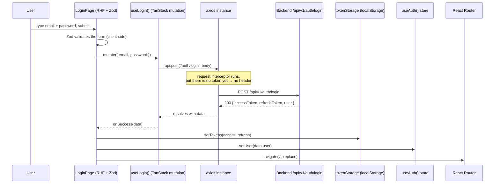
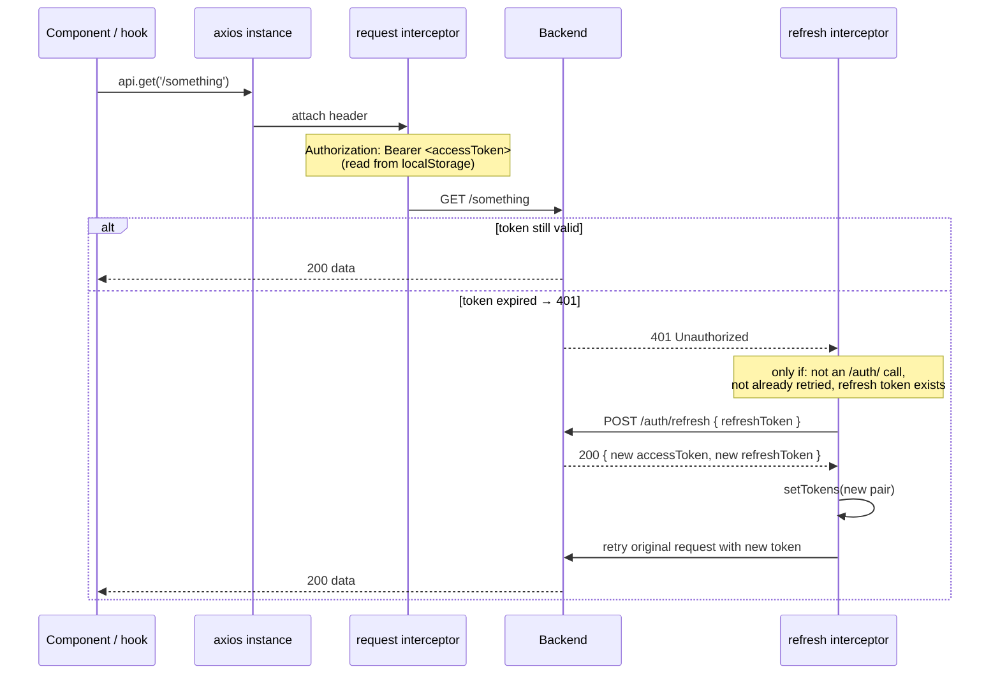
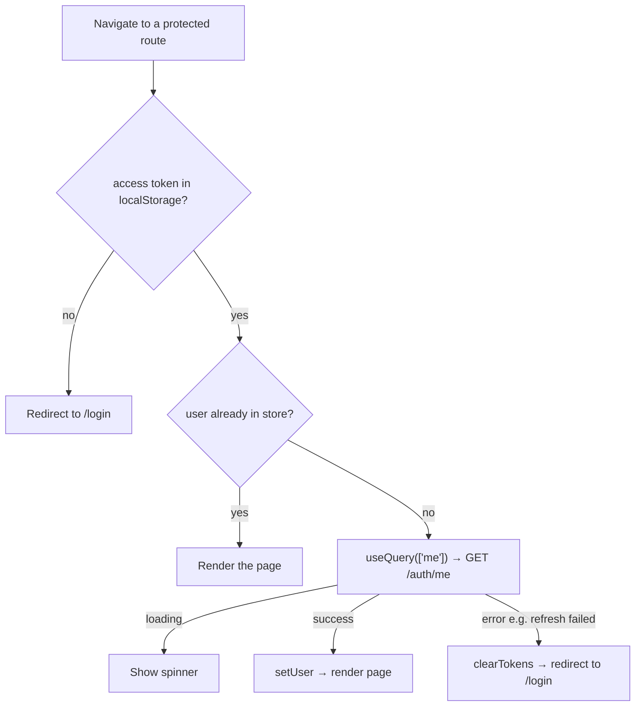
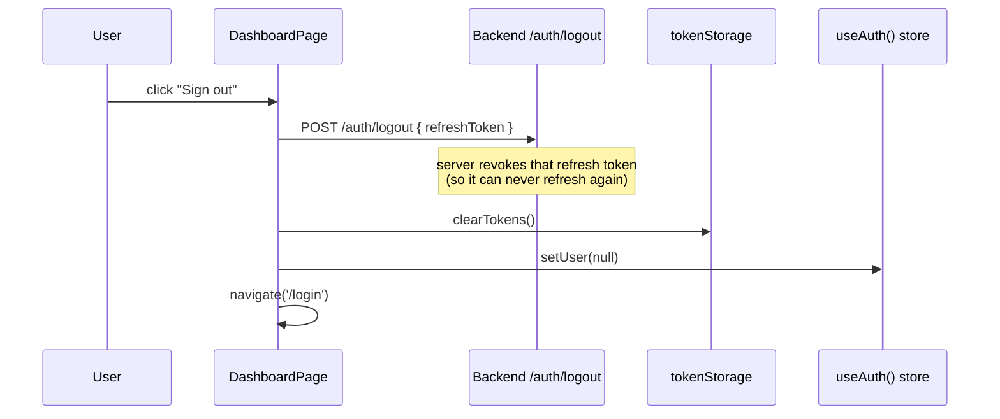

# RevenueOS Frontend — Login Flow (deep dive)

A guided tour of how authentication works in the frontend. Read top to bottom;
the diagrams show *what calls what*, and the annotated code explains *why*.

---

## 1. Who does what (the four moving parts)

| Layer | File | Responsibility |
| ----- | ---- | -------------- |
| **HTTP client** | `src/lib/axios.ts` | One Axios instance. Attaches the token to every request, and silently refreshes it on a 401. |
| **Token store** | `src/lib/tokenStorage.ts` | Reads/writes access + refresh tokens in `localStorage`. Lives *outside* React so the Axios interceptor can use it synchronously. |
| **Server state** | `src/api/auth.ts` + TanStack Query | Calls the API (`login`, `/me`, `logout`) and caches the results. |
| **Client state** | `src/store/auth.ts` (`redux-toolkit-state`) | Holds the *current user* object for the React tree. **No tokens here** — those live in `localStorage`. |
| **Routing guard** | `src/routes/ProtectedRoute.tsx` | Blocks private pages, and rebuilds the session from `/me` after a page refresh. |

> 🔑 **Key idea:** tokens and user are stored separately on purpose.
> *Tokens* must be readable by plain JS (the Axios interceptor isn't a React
> component), so they go in `localStorage`. The *user object* drives the UI, so
> it goes in the global React store.

---

## 2. Logging in (form → tokens → redirect)



### Annotated: `LoginPage.tsx` submit handler

```tsx
const onSubmit = (values: LoginForm) => {
  loginMutation.mutate(values, {
    onSuccess: (data) => {
      // (1) Persist tokens FIRST — the next request's interceptor reads them from here.
      setTokens(data.accessToken, data.refreshToken)
      // (2) Put the user in global state so the whole app knows we're authenticated.
      setUser(data.user)
      // (3) Go to where the user was headed (or home). `replace` so Back doesn't return to /login.
      navigate(redirectTo, { replace: true })
    },
  })
}
```

On failure, nothing is stored; `loginMutation.isError` is true and the page
shows the message (401 → "Invalid email or password", mapped in `errorMessage()`).

---

## 3. What happens on every authenticated request

Once logged in, any call through the `api` instance gets the token attached
automatically. If the token has expired, the client refreshes it **once**,
transparently, and retries — the user never sees it.



### Annotated: `axios.ts` interceptors

```ts
// --- REQUEST: stamp every outgoing call with the current access token ---
api.interceptors.request.use((config) => {
  const token = getAccessToken()           // read synchronously from localStorage
  if (token) config.headers.Authorization = `Bearer ${token}`
  return config
})

// A single shared refresh promise, so 5 simultaneous 401s trigger ONE refresh, not five.
let refreshPromise: Promise<string | null> | null = null

// --- RESPONSE: catch 401s and transparently refresh ---
api.interceptors.response.use(
  (response) => response,
  async (error) => {
    const original = error.config
    const status = error.response?.status
    const isAuthCall = original?.url?.includes('/auth/')   // don't loop on login/refresh itself

    if (status === 401 && original && !original._retry && !isAuthCall && getRefreshToken()) {
      original._retry = true                 // mark so we never retry the same request twice
      refreshPromise = refreshPromise ?? refreshAccessToken()  // de-dupe concurrent refreshes
      const newToken = await refreshPromise
      refreshPromise = null
      if (newToken) {
        original.headers.Authorization = `Bearer ${newToken}`
        return api(original)                 // replay the original request
      }
    }
    return Promise.reject(error)             // give up → caller handles it (usually redirect to /login)
  },
)
```

> 🔎 **Internal:** `refreshAccessToken()` uses a *raw* `axios.post` (not the `api`
> instance). If it used `api`, a failing refresh would hit this same interceptor
> and loop forever. Using raw axios breaks the cycle.

---

## 4. Surviving a page refresh (rehydration)

`localStorage` keeps the tokens across a browser refresh, but the React store is
wiped (it lives in memory). `ProtectedRoute` rebuilds the user from the token by
calling `/me`.



### Annotated: `ProtectedRoute.tsx`

```tsx
const hasToken = !!getAccessToken()

// Only fetch /me when we have a token but no user yet (i.e. right after a refresh).
const meQuery = useQuery({
  queryKey: ['me'],
  queryFn: fetchMe,
  enabled: hasToken && !user,   // <- the guard that prevents needless calls
  retry: false,
})

useEffect(() => {
  if (meQuery.data) setUser(meQuery.data)  // rehydrate the store once /me returns
}, [meQuery.data, setUser])

if (!hasToken) return <Navigate to="/login" ... />           // never authenticated
if (!user && meQuery.isLoading) return <Spinner />           // waiting on /me
if (!user && meQuery.isError) { clearTokens(); return <Navigate .../> }  // token dead
return <Outlet />                                            // authenticated → render children
```

---

## 5. Logging out



Even if the network call fails, the client still clears local tokens and state —
logout must always succeed locally.

---

## 6. How the pieces are wired at startup (`main.tsx`)

```tsx
<QueryClientProvider client={queryClient}>   {/* TanStack Query: server-state cache */}
  <BrowserRouter>                            {/* routing */}
    <App />                                  {/* routes + ProtectedRoute */}
  </BrowserRouter>
</QueryClientProvider>
```

`redux-toolkit-state` needs no provider — its store is global by design, so
`useAuth()` works anywhere.

---

## 7. One-line mental model

> **localStorage holds the keys (tokens); the store holds who you are (user);
> TanStack Query talks to the server; Axios glues them together and quietly
> re-keys itself when a token expires.**
